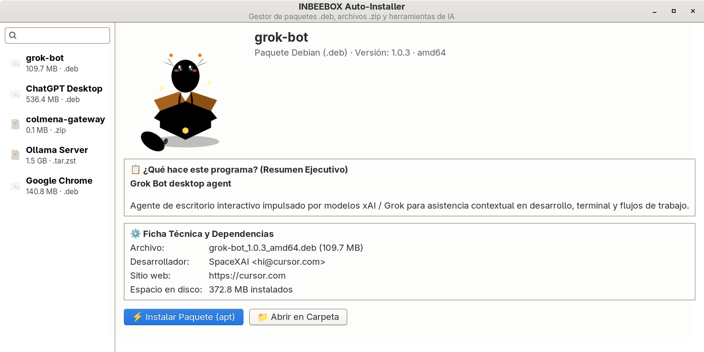

# 🐝 INBEEBOX Auto-Installer

<p align="center">
  
</p>

<p align="center">
  <b>Gestor Inteligente de Paquetes Debian (.deb), Archivos ZIP y Herramientas de IA</b><br />
  <i>Construido por <b>iArtLabs</b> & el agente autónomo <b>Antigravity</b> (Google DeepMind)</i>
</p>

---

## 🚀 Características Principales

- **Resumen Ejecutivo Automático:** Lee e interpreta los metadatos de los paquetes antes de instalarlos, explicando qué hace cada programa, su versión, desarrollador, dependencias y tamaño en disco.
- **Descompresión Inteligente:** Desempaqueta archivos `.zip` en subdirectorios limpios, detecta scripts de instalación (`install.sh`, `setup.sh`), otorga permisos de ejecución e identifica instaladores anidados.
- **Interfaz Gráfica Nativa (GTK3):** Diseñada para integrarse visualmente en entornos GNOME/Wayland y X11 con soporte para modo oscuro.
- **Integración con el Administrador de Archivos:**
  - Doble clic directo en paquetes `.deb`.
  - Menú contextual en Nautilus: Clic derecho -> *Scripts* -> *⚡ Instalar o Desempaquetar*.
- **Modo Terminal (CLI):** Capacidad de operación completa en consola mediante `auto-installer --cli`.
- **Ejecución Privilegiada Segura:** Compatible con elevación de permisos mediante `sudo-askpass` o `pkexec` sin exponer credenciales en la terminal.

---

## 📸 Vista Previa

<p align="center">
  
</p>

---

## 📦 Instalación Rápida

Para instalar en tu sistema local:

```bash
git clone https://github.com/ART449/inbeebox-auto-installer.git
cd inbeebox-auto-installer
./install.sh
```

El script configurará:
1. El ejecutable en `~/.local/bin/inbeebox-installer` y el alias `auto-installer`.
2. Los iconos en `~/.local/share/icons/`.
3. El lanzador de escritorio en `~/.local/share/applications/`.
4. El script de contexto para Nautilus en `~/.local/share/nautilus/scripts/`.

---

## 🛠️ Uso

### 1. Interfaz Gráfica
Ejecuta desde tu terminal o menú de aplicaciones:
```bash
auto-installer
```
O simplemente haz doble clic sobre cualquier paquete `.deb` descargado.

### 2. Inspeccionar un paquete específico
```bash
auto-installer /ruta/hacia/paquete.deb
# o archivo comprimido
auto-installer /ruta/hacia/archivo.zip
```

### 3. Modo Terminal (CLI)
```bash
auto-installer --cli /ruta/hacia/paquete.deb
```

---

## 📄 Créditos y Licencia

Desarrollado y mantenido por:
- **iArtLabs**
- **Agente Antigravity** (Google DeepMind)

Distribuido bajo licencia **MIT**.
